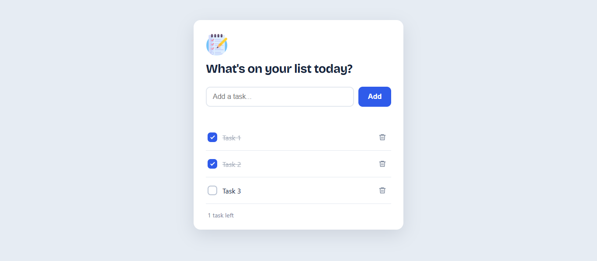

# Task List

A clean, responsive to-do list built with vanilla HTML, CSS, and JavaScript. Tasks are saved in your browser, so they are still there after a refresh.

**Live demo:** [your-username.github.io/your-repo-name](https://your-username.github.io/your-repo-name)



## Features

- Add tasks with the **Add** button or the **Enter** key
- Empty tasks are blocked with a clear inline message
- Mark tasks as completed (strikethrough and dimmed)
- Delete tasks with smooth fade-in and fade-out transitions
- Tasks persist with `localStorage`
- Responsive layout that works on phones and desktops
- Keyboard-friendly and screen-reader-friendly (labels, focus styles, `aria-live` messages)

## Tech stack

- HTML5
- CSS3 (custom properties, Flexbox, transitions, keyframe animations)
- JavaScript (ES6+, DOM manipulation, Web Storage API)

No frameworks or libraries.

## Getting started

```bash
git clone https://github.com/your-username/your-repo-name.git
cd your-repo-name
```

Open `index.html` in your browser. No build step or install needed.

## Project structure

```
.
├── index.html   # Page structure
├── style.css    # Styling and animations
├── script.js    # App logic and localStorage
└── README.md
```

## What I learned

- Creating and removing elements with the DOM API
- Handling events (`submit`, `change`, `click`, `input`)
- Saving and loading data with `localStorage` and `JSON`
- Validating user input
- Building a responsive layout and accessible UI

## Future improvements

- Edit existing tasks
- Filter by All / Active / Completed
- Drag-and-drop reordering
- Due dates and a dark mode

## Author

**Your Name**
[LinkedIn](https://linkedin.com/in/your-profile) · [GitHub](https://github.com/your-username)
